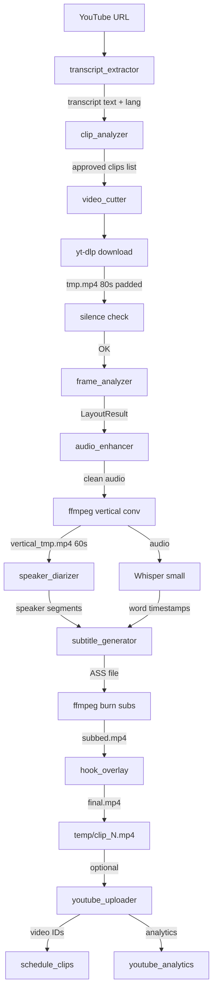

# Arquitectura del pipeline — yt-clipper

Documentación técnica completa de cada paso, modelos y parámetros clave.

---

## Pipeline completo

```
┌──────────────────────────────────────────────────────────────────┐
│                    INPUT: YouTube URL                            │
└──────────────────────────┬───────────────────────────────────────┘
                           │
          ┌────────────────▼─────────────────┐
          │  PASO 1 — TRANSCRIPT             │
          │  • yt-dlp detecta idioma         │
          │  • youtube-transcript-api        │
          │    (captions manuales → auto)    │
          │  • Fallback: Whisper small (GPU) │
          └────────────────┬─────────────────┘
                           │ texto con timestamps [HH:MM:SS]
          ┌────────────────▼─────────────────┐
          │  PASO 2 — LLM DOS AGENTES        │
          │  ┌──────────────────────────┐    │
          │  │ Agent 1: FINDER          │    │
          │  │ DeepSeek v3 via Novita   │    │
          │  │ → propone max_clips × 2  │    │
          │  └──────────┬───────────────┘    │
          │             │ candidatos JSON     │
          │  ┌──────────▼───────────────┐    │
          │  │ Agent 2: REVIEWER        │    │
          │  │ DeepSeek v3 via Novita   │    │
          │  │ → puntúa 1-10            │    │
          │  │ → rechaza <7             │    │
          │  │ → genera título/desc/tags│    │
          │  └──────────┬───────────────┘    │
          └─────────────┼────────────────────┘
                        │ clips aprobados (con score, hook, timestamps)
          ┌─────────────▼─────────────────────────────┐
          │  PASOS 3–11 (por cada clip aprobado)       │
          │                                            │
          │  3. DOWNLOAD (yt-dlp HLS + Firefox cookies)│
          │  4. SILENCE CHECK (ffmpeg silencedetect)   │
          │  5. FRAME ANALYSIS (OpenCV + frame diff)   │
          │  6. AUDIO ENHANCE (noisereduce)             │
          │  7. VERTICAL CONV (ffmpeg filter_complex)  │
          │  8. DIARIZATION (Resemblyzer)               │
          │  9. SUBTÍTULOS (Whisper small → ASS)       │
          │  10. HOOK OVERLAY (ffmpeg drawtext)        │
          │  11. B-ROLL (Pexels API + ffmpeg) [opt]    │
          └─────────────┬──────────────────────────────┘
                        │
          ┌─────────────▼──────────────────┐
          │  OUTPUT: 1080×1920 MP4         │
          │  (subtítulos + hook quemados)  │
          └─────────────┬──────────────────┘
                        │
          ┌─────────────▼──────────────────┐
          │  UPLOAD + SCHEDULE [opcional]  │
          │  YouTube Data API v3           │
          │  YouTube Analytics API v2      │
          └────────────────────────────────┘
```

---

## Paso 1 — Extracción de transcript

**Módulo:** `src/transcript_extractor.py`

```
URL ──► parse_video_id()
           │
           ▼
      _detect_language()
      yt-dlp --print "%(language)s"
      → "es-US" → base "es"
           │
           ▼
      fetch_transcript(video_id, preferred_lang="es")
           │
           ├─► youtube-transcript-api.list()
           │       │
           │       ├─► manual transcripts (prioridad) → snippets
           │       └─► auto-generated (filtrado por lang) → snippets
           │
           └─► RuntimeError → _whisper_transcribe()
                   │
                   ├─► yt-dlp descarga audio (HLS, original lang)
                   └─► whisper.load_model("small").transcribe()
                           word_timestamps=True
                           → segments con words[{start, end, word}]
```

**Lógica de selección de idioma:**
```
yt-dlp detecta idioma del video ("es-US")
    │
    ▼
Busca transcript en ese idioma
    │
    ├─ Manual en "es" → usa ese (mejor calidad)
    ├─ Auto-generado en "es" → usa ese
    └─ Ninguno → Whisper transcribe el audio completo
```

**Modelo:** OpenAI Whisper `small` (244M params, ~12× tiempo real en GPU)
- Descargado automáticamente a `~/.cache/whisper/`
- Detecta idioma automáticamente si no se especifica
- `word_timestamps=True` → timestamps por palabra (necesario para subtítulos)

---

## Paso 2 — Dos agentes LLM

**Módulo:** `src/clip_analyzer.py`

```
TRANSCRIPT TEXT (con timestamps [HH:MM:SS])
    │
    ▼
┌─────────────────────────────────────────────────────────────┐
│  AGENT 1: FINDER                                            │
│  Model: DeepSeek v3 (via Novita.ai)                         │
│  Temperature: 0.3                                           │
│                                                             │
│  System: "Eres content strategist. Identifica momentos      │
│   clave. Escribe en {language}. Propón {max_clips × 2}      │
│   candidatos."                                              │
│                                                             │
│  Output JSON:                                               │
│  { candidates: [                                            │
│    { clip_id, start_seconds, end_seconds,                   │
│      start_time, end_time, rationale, hook }                │
│  ]}                                                         │
└────────────────────────┬────────────────────────────────────┘
                         │ candidatos
                         ▼
┌─────────────────────────────────────────────────────────────┐
│  AGENT 2: REVIEWER                                          │
│  Model: DeepSeek v3 (via Novita.ai)                         │
│  Temperature: 0.3                                           │
│                                                             │
│  System: "Eres curador. Puntúa 1-10. Aprueba ≥7.            │
│   Ajusta timestamps ±10s. Escribe metadata en {language}."  │
│                                                             │
│  Output JSON:                                               │
│  { reviewed: [                                              │
│    { clip_id, score, approved, rejection_reason,            │
│      title (≤100c), description (≤500c),                    │
│      tags, hook, start/end_seconds }                        │
│  ]}                                                         │
└────────────────────────┬────────────────────────────────────┘
                         │ filtrado por score ≥ 7
                         ▼
                  clips aprobados
                  (ordenados por score desc)
```

**Modos de extracción:**

| Modo | Instrucción al Reviewer |
|------|------------------------|
| `shorts` | Hook en primeros 3s, 30–90s, "scroll-stopper" |
| `standard` | Arco setup → insight → payoff, 2–8min |
| `emotion` | Picos emocionales, reacciones, "aha!", 30–90s |
| `topic` | Solo clips sobre `{topic}`, rechaza menciones de pasada |

**Scoring del Reviewer (idéntico a OpusClip):**

```
score ≤ 4  →  Rank C  (rechazado)
score ≤ 6  →  Rank B  (rechazado)
score ≤ 8  →  Rank A-
score > 8  →  Rank A
```

---

## Paso 3 — Descarga de video

**Módulo:** `src/video_cutter.py` → `_ytdlp_cmd()`

```
Segmento solicitado: start=300s, end=360s

PADDING = 10s cada lado
    │
    ▼
Descarga: [290s, 370s]  (80s totales)

Formato seleccionado (en orden de prioridad):
  1. bestvideo[protocol^=m3u8]+bestaudio[language^=es][protocol^=m3u8]
     → HLS 1080p + HLS audio español original
  2. bestvideo[protocol^=m3u8]+bestaudio[language^=es]
     → HLS video + HTTPS audio español
  3. bestvideo[protocol^=m3u8]+bestaudio
     → HLS video + mejor audio disponible
  4. best
     → lo que sea

¿Por qué HLS primero?
  HTTPS (format 137) → a veces 403 Forbidden en IPs de servidor
  HLS (format 270)   → siempre funciona, usa Cloudflare CDN

Cookies: --cookies-from-browser firefox
  → evita bot-detection de YouTube en live streams
```

**Después de la descarga:**
```
trim_offset = start - padded_start = 300 - 290 = 10s
duration    = end - start = 60s

ffmpeg -ss 10 -t 60 → clip preciso de 60s
       ↑
       trim dentro del archivo descargado (no re-descarga)
```

---

## Paso 4 — Detección de silencio

**Módulo:** `src/video_cutter.py` → `_check_silence()`

```
ffmpeg silencedetect:
  noise threshold = -35 dB
  min duration    = 1.5 s

Ejemplo resultado:
  silence_start: 5.2
  silence_end: 8.1    → 2.9s silencio
  silence_start: 45.0
  (sin end)           → hasta fin del clip = 15s silencio

Total silencio: 17.9s / 60s = 29.8%

SILENCE_MAX = 40%

29.8% < 40% → ✅ OK, continúa
```

```
         0s    5s   10s   20s   30s   40s   45s   60s
         ├─────┼────┼─────┼─────┼─────┼─────┼─────┤
Audio:   ████████   ████████████████████████        
Silencio:         ███                          ███████
                  2.9s                         15s

Ratio: 17.9/60 = 29.8%  →  PASA
```

---

## Paso 5 — Análisis de frames

**Módulo:** `src/frame_analyzer.py`

### 5a. Detección de cara

```
12 frames muestreados del clip (distribuidos uniformemente)
    │
    ▼
Por cada frame:
  convertir a escala de grises
  Haar Cascade detectMultiScale:
    scaleFactor = 1.05 (paso de escala pequeño = más detecciones)
    minNeighbors = 3   (menos estricto)
    minSize = 5% del ancho (filtra miniaturas <96px)
  Queda: la DETECCIÓN MÁS GRANDE del frame (descarta miniaturas)
    │
    ▼
Mediana de todas las detecciones → bounding box robusto
    │
    ▼
Expandir a panel cuadrado centrado en la cara:
  panel_w = frame_w - face_panel_start_x
  panel_h = min(panel_w, frame_h)  ← CLAMPED a altura del frame
  panel_y = face_cy - panel_h/2    ← centrado verticalmente
    │
    ▼
Screen region = mayor rectángulo NO cubierto por el panel
  (izquierda, derecha, arriba o abajo del panel)
```

**Modelo:** OpenCV Haar Cascade `haarcascade_frontalface_default.xml`
- Descargado desde GitHub (OpenCV 4.x) en `~/.cache/yt-clipper/`
- Detectada en 12 frames → mediana → robusto ante oclusiones y falsos positivos

### 5b. Detección de actividad del cursor

```
12 frames → extraer solo región de pantalla
    │
    ▼
Frame differencing:
  diff[i] = |frame[i+1] - frame[i]|  (valor absoluto, pixel a pixel)
  heat = mean(diff[0..10])  → mapa de calor promedio
    │
    ▼
Gaussian blur(31×31) → suavizar ruido de compresión
    │
    ▼
Centroide ponderado del top 15% de píxeles
  cx = Σ(x × heat[x,y]) / Σ(heat[x,y])   para heat > percentil_85
  cy = Σ(y × heat[x,y]) / Σ(heat[x,y])
    │
    ▼
activity_cx, activity_cy = posición del cursor/acción
```

```
Frame diff (ejemplo):
  ░░░░░░░░░░░░░░░░░░░░░░░░░░░░░░
  ░░░░░░░░░░▓▓▓▓▓▓▓░░░░░░░░░░░░  ← zona de código activo
  ░░░░░░░░░░▓▓█████▓░░░░░░░░░░░  ← centroide aquí
  ░░░░░░░░░░▓▓▓▓▓▓▓░░░░░░░░░░░░
  ░░░░░░░░░░░░░░░░░░░░░░░░░░░░░░

█ = centroide de actividad (cursor/ratón)
```

---

## Paso 6 — Conversión vertical

**Módulo:** `src/video_cutter.py` → `_build_vf()`

```
INPUT: 1920×1080 landscape
OUTPUT: 1080×1920 vertical (9:16)

FACE_RATIO = 0.38

face_h   = 1920 × 0.38 = 728px  (forzado a par)
screen_h = 1920 - 728  = 1192px (forzado a par)
```

**ffmpeg filter_complex:**

```
[0:v] trim=start=10:duration=60, setpts=PTS-STARTPTS
   │
   ├─► PANEL CARA (top 38%)
   │   crop={face_panel.w}:{face_panel.h}:{face_panel.x}:{face_panel.y}
   │   scale=1080:1080        ← escala el cuadrado a 1080×1080
   │   crop=1080:728:0:(ih-728)/2  ← center-crop a altura correcta
   │                               ← cara SIEMPRE visible (centrada)
   │   → [top]
   │
   └─► PANEL PANTALLA (bottom 62%)
       crop={zoom.w}:{zoom.h}:{zoom.x}:{zoom.y}
              ↑ zoom crop centrado en activity_cx/cy
              ↑ zoom.w = screen.h × (1080/1192) ≈ 978px (mismo AR que panel)
              ↑ → ~1.6× zoom sobre el original
       scale=1080:1192        ← escala a tamaño final exacto
       → [bottom]

[top][bottom] vstack=inputs=2 → [v]

-t 60   ← CRÍTICO: trunca audio y video al mismo punto
         (sin esto: video=60s, audio=80s → frame congelada 20s)
```

**Resultado visual:**
```
┌─────────────────┐  ← 1080px ancho
│                 │
│   CARA (38%)   │  ← 728px alto
│  Daniel García  │
│                 │
├─────────────────┤
│                 │
│  PANTALLA (62%)│  ← 1192px alto
│  código/browser │  ← zoom ~1.6× sobre zona de cursor
│  legible        │
│                 │
└─────────────────┘  ← 1920px total
```

**Aspect ratios soportados:**

| `--aspect` | Output | Uso |
|------------|--------|-----|
| `9:16` (default) | 1080×1920 | YouTube Shorts, TikTok, Reels |
| `1:1` | 1080×1080 | Instagram Feed, LinkedIn |
| `16:9` | original | YouTube estándar |

---

## Paso 7 — Mejora de audio

**Módulo:** `src/audio_enhancer.py`

```
INPUT: video con audio de stream (ruido ambiente, ventiladores, etc.)

1. ffmpeg extrae audio → WAV 44100Hz mono PCM
   │
2. soundfile.read() → numpy array float32
   │
3. noisereduce.reduce_noise():
   noise_clip = primeros 0.5s (generalmente silencio/ambiente)
   prop_decrease = 0.85  ← agresividad NR (85% reducción)
   stationary = False    ← NR no-estacionaria (mejor para voz)
   n_fft = 1024          ← resolución frecuencial
   │
   Algoritmo: Wiener filter adaptativo en dominio frecuencial
   Estima PSD del ruido → atenúa en tiempo-frecuencia
   │
4. soundfile.write() → WAV limpio
   │
5. ffmpeg recombina:
   -map 0:v (video original)
   -map 1:a (audio limpio)
   → MP4 con audio denoised
```

**Biblioteca:** `noisereduce` v3 (basada en el algoritmo de Audacity)

---

## Paso 8 — Diarización de speakers

**Módulo:** `src/speaker_diarizer.py`

```
INPUT: audio del clip (MP3)

1. Preprocesado: resample → WAV 16kHz mono (necesario para Resemblyzer)
   │
2. Resemblyzer.VoiceEncoder ("cpu"):
   Ventana deslizante: 1.5s, paso 0.5s
   Por cada ventana → embedding 256D (d-vector)
   Total embeddings ≈ 60s / 0.5s = 120 embeddings
   │
3. Estimación de número de speakers:
   Calcular similitud coseno media entre todos los embeddings
   avg_sim > 0.92 → 1 speaker
   avg_sim > 0.80 → 2 speakers
   avg_sim > 0.70 → 3 speakers
   avg_sim ≤ 0.70 → 4 speakers
   │
4. Agglomerative Clustering (scikit-learn):
   metric = cosine, linkage = average
   n_clusters = estimado
   → etiqueta 0,1,2... por ventana
   │
5. Merge ventanas consecutivas del mismo speaker
   min_segment_s = 1.0s
   │
6. Asignar colores (OpusClip):
   Speaker 0 → #979BFF (púrpura)
   Speaker 1 → #FFDA7D (amarillo)
   Speaker 2 → #C3FF7A (verde)
   Speaker 3 → #97F8F8 (cyan)
   Speaker 4 → #FF759A (rosa)
```

**Modelo:** Resemblyzer (GE2E speaker encoder, ~17M params)
- Pre-entrenado en LibriSpeech + VoxCeleb2
- Embeddings de 256 dimensiones por segmento de voz
- Funciona sin GPU (CPU es suficiente para 60s)

---

## Paso 9 — Subtítulos TikTok

**Módulo:** `src/subtitle_generator.py`

```
INPUT: segments de Whisper con word_timestamps=True
       [{start, end, text, words: [{word, start, end}...]}]

1. Whisper transcribe SOLO el audio del clip (0..60s)
   → sin drift, timestamps precisos
   │
2. Agrupar en frases de 3 palabras (WORDS_PER_PHRASE = 3)
   │
3. Por cada palabra dentro de su frase:
   Generar evento ASS:
   Dialogue: 0, {word.start}, {word.end}, TikTok,,0,0,0,,{texto_coloreado}
   │
4. Texto coloreado según estilo:
```

**Estilos de subtítulos:**

```
KARAOKE (default):
  Frase: "cómo modelo  esto"
                  ↑ palabra activa
  ASS: cómo modelo {\c&H0000FFFF&}esto{\c&H00FFFFFF&}
                    ←── amarillo ──→ ←── blanco ──→

WORDBOX:
  Similar pero la palabra activa tiene fondo naranja sólido
  BorderStyle=4 en el ASS header

CLEAN:
  Texto blanco únicamente, sin highlight
  Ideal para contenido profesional

EMOJI:
  Como karaoke + inyección de emoji tras keywords:
  "modelo 🤖" "error ❌" "gratis 🎁" "python 🐍"
```

**Posicionamiento:**
```
PlayResX: 1080, PlayResY: 1920
MarginV: 400   ← 400px desde el fondo
Alignment: 2   ← centrado horizontal, anclado abajo

Zona visual:
┌──────────────────────┐ y=0
│     CARA             │
├──────────────────────┤ y=728
│                      │
│     PANTALLA         │
│                      │
│  ┌──────────────┐    │
│  │ texto activo │    │ y=1520 (1920-400)
│  └──────────────┘    │
└──────────────────────┘ y=1920
```

**Con diarización activa:**
```
Speaker 0 habla → amarillo reemplazado por #979BFF (púrpura)
Speaker 1 habla → amarillo reemplazado por #FFDA7D (amarillo dorado)
→ el espectador sabe visualmente cuándo cambia el locutor
```

---

## Paso 10 — Hook overlay

**Módulo:** `src/hook_overlay.py`

```
Hook text (del Reviewer LLM):
"¡IA juega Flappy Bird en TIEMPO REAL en mi GPU!"

Templates disponibles:
```

| Template | Color texto | Fondo | Posición |
|----------|-------------|-------|----------|
| `hook-01` | Blanco | Sin fondo | Centro, y=72% |
| `hook-02` | Negro | **Caja amarilla** (#F1C329) | Centro, y=70% |
| `hook-03` | Blanco | Barra oscura | **Arriba**, y=8% |
| `hook-04` | **Dorado** (#F1C329) | Sin fondo | Centro, y=65% |
| `hook-05` | Blanco | Barra negra 75% | Centro, y=75% |

```
ffmpeg drawtext filter:
  text='{hook_text}'
  fontsize=72
  x=(w-text_w)/2        ← centrado horizontal
  y=h*0.70              ← 70% altura del frame
  alpha='if(lt(t,0.3), t/0.3,
         if(lt(t,2.7), 1,
         (3.0-t)/0.3))'  ← fade in 0.3s, fade out 0.3s

Duración visible: primeros 3 segundos del clip
```

**Autowrap:** textos >28 caracteres se parten en múltiples líneas.

---

## Paso 11 — B-Roll (opcional)

**Módulo:** `src/broll_inserter.py`

```
1. LLM extrae 3 keywords visuales del transcript:
   "Flappy Bird jugando en tiempo real" → ["bird flying", "neural network", "GPU gaming"]
   │
2. Pexels API search (portrait/vertical):
   GET https://api.pexels.com/videos/search?query={keyword}&orientation=portrait
   → URLs de vídeos HD 9:16
   │
3. Descarga el primer resultado disponible
   │
4. Crop/scale B-roll al tamaño del panel de pantalla:
   scale=1080:{screen_h}:force_original_aspect_ratio=increase
   crop=1080:{screen_h}
   │
5. ffmpeg overlay:
   [original][broll]overlay=x=0:y={face_h}:enable='between(t,5,9)'
   ← B-roll aparece en el panel de pantalla entre segundos 5-9
   ← La cara sigue visible en el panel superior
```

---

## Modelos y servicios — resumen completo

| Paso | Componente | Modelo / Servicio | Parámetros clave |
|------|-----------|-------------------|-----------------|
| Detección idioma | `transcript_extractor` | yt-dlp `%(language)s` | — |
| Captions | `transcript_extractor` | youtube-transcript-api v1 | manual > auto, lang priority |
| Transcripción fallback | `transcript_extractor` | **Whisper small** (244M) | word_timestamps=True, GPU |
| Subtítulos del clip | `video_cutter` | **Whisper small** (244M) | 0..duration, sin drift |
| Selección de clips | `clip_analyzer` | **DeepSeek v3** via Novita | temp=0.3, JSON manual |
| Scoring/metadata | `clip_analyzer` | **DeepSeek v3** via Novita | temp=0.3, score 1-10 |
| Detección de cara | `frame_analyzer` | **OpenCV Haar Cascade** | scale=1.05, minN=3, minSize=5% |
| Actividad/cursor | `frame_analyzer` | Frame differencing + blur | Gaussian 31×31, percentil 85 |
| Diarización | `speaker_diarizer` | **Resemblyzer** GE2E (17M) | 256D embeddings, CPU |
| Clustering speakers | `speaker_diarizer` | Agglomerative Clustering | metric=cosine, linkage=avg |
| Noise reduction | `audio_enhancer` | **noisereduce** Wiener | prop_decrease=0.85, non-stationary |
| Hook overlay | `hook_overlay` | ffmpeg drawtext | 5 templates, fade in/out |
| B-roll search | `broll_inserter` | **Pexels API** | portrait, HD |
| Descarga video | `video_cutter` | **yt-dlp** + Firefox cookies | HLS priority, original lang audio |
| Conversión vertical | `video_cutter` | **ffmpeg** filter_complex | CRF=18, 4M bitrate floor |
| Upload YouTube | `youtube_uploader` | YouTube Data API v3 | resumable, 1600 units/upload |
| Analytics | `youtube_analytics` | YouTube Analytics API v2 | channel, video, traffic, devices |
| Scheduling | `schedule_clips` | YouTube Data API v3 | private + publishAt UTC |

---

## Flujo de datos entre módulos



---

## Parámetros tuneables

| Constante | Archivo | Default | Efecto |
|-----------|---------|---------|--------|
| `PADDING` | `video_cutter.py` | `10` | Segundos extra descargados a cada lado |
| `FACE_RATIO` | `video_cutter.py` | `0.38` | % altura del panel de cara |
| `SILENCE_DB` | `video_cutter.py` | `-35` | Threshold silencio (dB) |
| `SILENCE_DUR` | `video_cutter.py` | `1.5` | Mínimo tramo silencioso (s) |
| `SILENCE_MAX` | `video_cutter.py` | `0.40` | Máx fracción silencio antes de rechazar |
| `WORDS_PER_PHRASE` | `subtitle_generator.py` | `3` | Palabras por bloque de subtítulo |
| `MIN_GAP_DAYS` | `schedule_clips.py` | `2` | Días mínimos entre publicaciones |
| `PREFERRED_SLOTS` | `schedule_clips.py` | Dom/Vie/Jue 14:00 | Slots de publicación preferidos |
| Whisper model | `video_cutter.py` | `"small"` | Cambia a `"medium"` para más precisión |
| `prop_decrease` | `audio_enhancer.py` | `0.85` | Agresividad del noise reduction |
